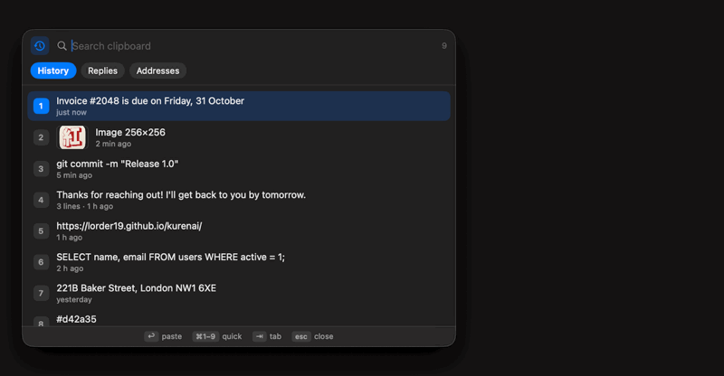
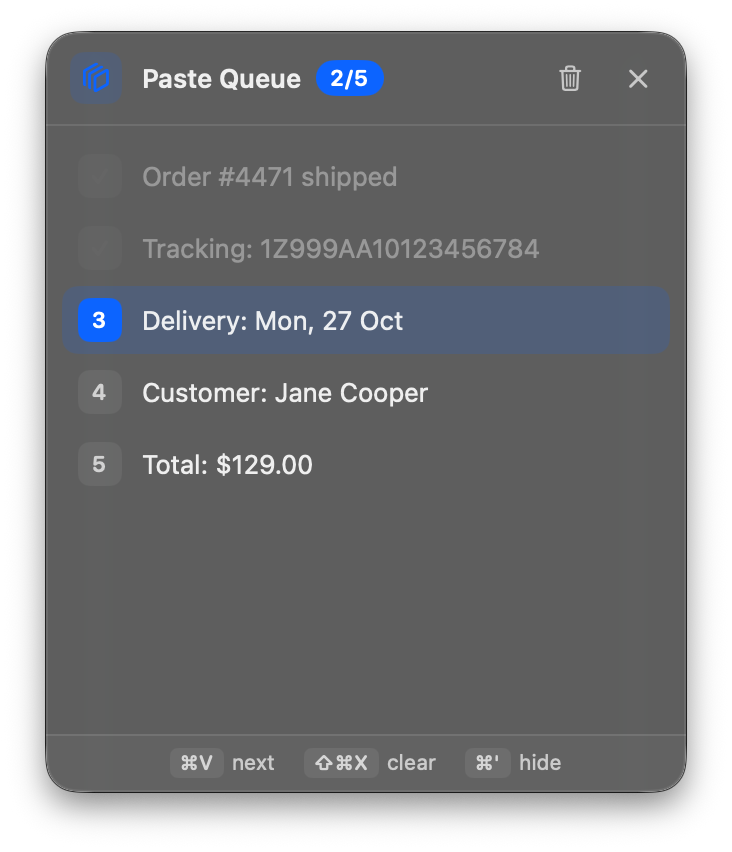
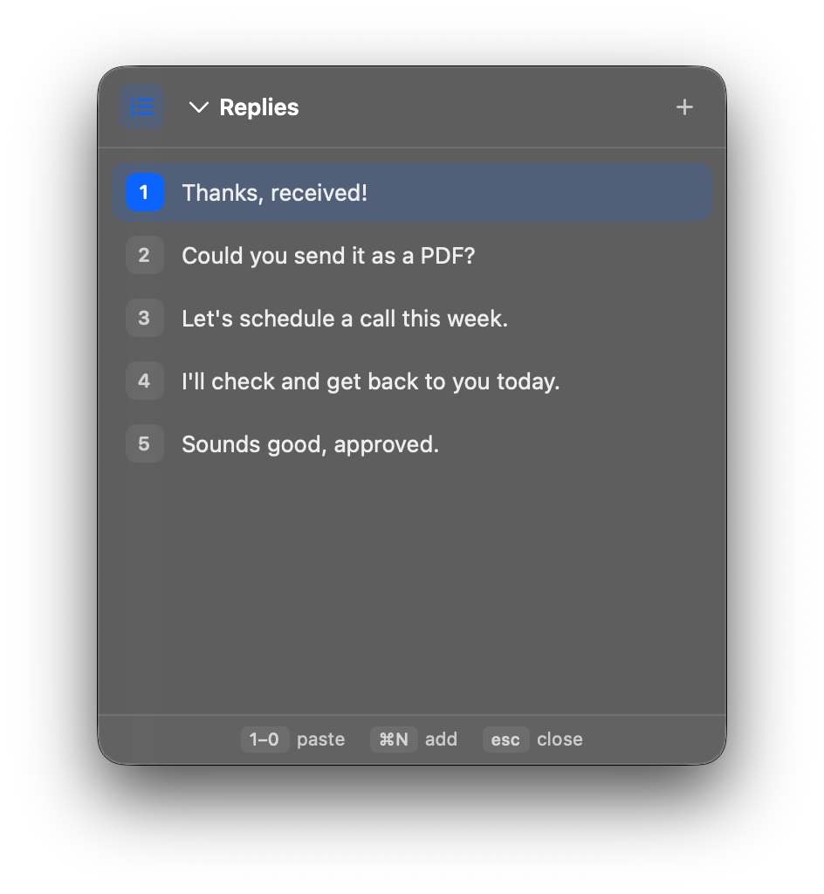

<p align="center"></p>

<h1 align="center">Kurenai</h1>

<p align="center">Clipboard history for the Mac. Small, free, open source.<br>
<a href="https://lorder19.github.io/kurenai/">Website</a> · <a href="https://github.com/Lorder19/kurenai/releases/latest">Download</a></p>

<p align="center">
<a href="https://github.com/Lorder19/kurenai/releases/latest"></a>
<a href="https://github.com/Lorder19/kurenai/releases"></a>
<a href="https://github.com/Lorder19/kurenai/actions/workflows/build.yml"></a>

</p>

<p align="center"></p>

I used CleanClip for years. After a macOS update it started crashing, and the alternatives I tried either wanted a subscription or did too much. So I wrote my own. Kurenai does three things and tries to stay out of the way. It used to be called Clippo.

## What it does

Press ⌘; to see what you copied recently, text and images. Type to search, hit ⌘1 to ⌘9 to paste one of the first nine.

Press ⌘I for your saved lists: canned replies, addresses, whatever you paste often. A digit pastes a line.

Press ⌘' for the paste queue. Copy a few things in a row, then every ⌘V pastes the next one. ⇧⌘C takes a selected column (from a spreadsheet, a log, anything) and queues it line by line. ⇧⌘X empties the queue.

<p align="center">
  
  
</p>

All shortcuts can be changed in Settings. The panels float over whatever you're working in and don't take focus away from it, so the paste lands where you expect.

## About your data

A clipboard manager sees everything you copy, so I tried to be careful:

* Passwords copied from 1Password, Bitwarden, Apple Passwords and other managers that mark them as concealed are never saved.
* You can list apps whose copies should be ignored (Keychain Access and Passwords are there by default).
* History and images are encrypted on disk (AES-GCM). The key sits next to the data, readable only by your user account, so this protects against the file leaking, not against someone who has your login.
* Kurenai windows are marked private: macOS screenshots skip them and they don't show up when you share your screen in Telegram. A few recording apps ignore that flag, so check yours if it matters.
* Nothing is sent anywhere. The one exception is a daily update check against GitHub, and it's off unless you turn it on.

Kurenai needs Accessibility permission for one thing: pressing ⌘V for you after you pick an item. It doesn't log keystrokes.

## Install

macOS 14 or newer, Apple Silicon or Intel.

With Homebrew:

```bash
brew install --cask lorder19/tap/kurenai
```

Or by hand:

1. Download `Kurenai.zip` from [Releases](https://github.com/Lorder19/kurenai/releases/latest), unzip, drag Kurenai into Applications.
2. Open it. macOS will say it can't check the developer, because I don't have a paid Apple developer account yet. Go to System Settings → Privacy & Security, scroll down, click "Open Anyway".
3. Turn Kurenai on in Accessibility when it asks.

The icon lives in the menu bar. If it's hidden behind the notch, open Kurenai again from Spotlight and you'll get the settings window.

To uninstall, quit Kurenai and delete the app and `~/Library/Application Support/Kurenai`.

## Building it yourself

```bash
git clone https://github.com/Lorder19/kurenai.git
cd kurenai
./build.sh install
```

You need the Xcode command line tools. Without a fixed signing certificate the build is signed ad hoc, which means macOS asks for Accessibility again after every rebuild. Create a self-signed code signing certificate called `Clipo Local Signing` in Keychain Access to avoid that.

`Kurenai -KurenaiDemo history` (or `list`, `queue`, `settings`) opens a window filled with sample data. That's how the screenshots are made; your real history isn't touched.

## Languages

English, Russian, Simplified Chinese. If you'd like to add yours, the strings are in `Resources/`.

## Feedback

Bugs go to [Issues](https://github.com/Lorder19/kurenai/issues), questions and ideas to [Discussions](https://github.com/Lorder19/kurenai/discussions). Want to help? See [CONTRIBUTING](CONTRIBUTING.md). What changed in each version is in the [changelog](CHANGELOG.md). If Kurenai saves you time, a star helps other people find it.

MIT license.

---

### По-русски

Kurenai это менеджер буфера обмена для Mac. Бесплатный, с открытым кодом, без аккаунтов. ⌘; открывает историю (текст и картинки), ⌘I ваши списки фраз, ⌘' очередь вставки: копируете несколько вещей подряд, а ⌘V вставляет их по одной. Пароли из менеджеров паролей не сохраняются, история на диске зашифрована.

Скачать можно в [Releases](https://github.com/Lorder19/kurenai/releases/latest). При первом запуске macOS предупредит о неизвестном разработчике: Системные настройки → Конфиденциальность и безопасность → «Всё равно открыть». Потом включите Kurenai в Универсальном доступе.
